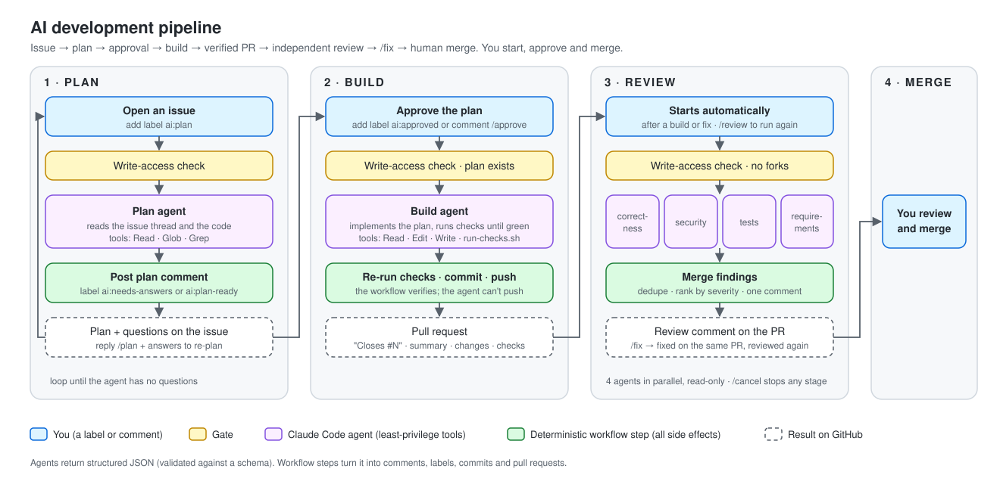
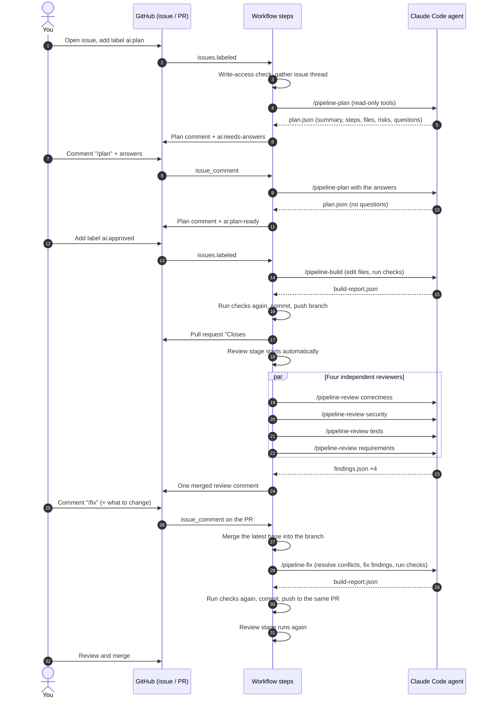

# Claude Code Dev Pipeline

A reference implementation of an **AI development pipeline on GitHub**: a person describes a change in an issue, and
[Claude Code](https://code.claude.com) agents plan it, ask questions, build it, test it, open a pull request, review
it and fix what the review finds — with a person approving the plan and merging every change.



This repository contains everything needed to add the pipeline to a project: GitHub Actions workflows, agent
prompts (Claude Code skills), JSON output contracts, the glue scripts, an installer and an offline test suite.
The workflow files live under [`templates/`](templates/) so nothing runs in this repository itself.

## Why

Coding agents can write code. The hard part in a real team is everything around it: knowing what to build,
keeping a person in control, limiting what an agent can touch, proving the result works, and getting an honest
review. This pipeline is built around those concerns rather than around the agent:

| Concern | How the pipeline handles it |
| --- | --- |
| Building the wrong thing | A **plan stage** studies the code and posts a plan with questions on the issue. Nothing is built until a person approves it. |
| Losing control | **A person starts the work** (a label or a `/command` to plan, a label to approve the build) and **merges every change**. The review runs automatically on the pull request the build opens. Agents never approve or merge. |
| Agents with too much power | **Least privilege per stage**: the planner and reviewers can only read; the builder can edit files and run one script. No agent has git, GitHub or network tools, and the build job can't push: a separate publish job on a fresh runner does. |
| "It works on my machine" | **Trust, but verify**: the builder runs the checks until they pass, then the workflow runs them again itself before it opens a pull request. |
| Unstructured agent output | Every agent returns **JSON validated against a schema**. Deterministic workflow steps turn it into comments, labels, commits and pull requests. |
| Review findings that never get fixed | **`/fix` on the pull request**: the agent brings the branch up to date (resolving conflicts), fixes the review's findings or what you ask, re-checks and pushes to the same pull request, and the review runs again. |
| Waiting blind / runaway runs | Every stage posts **⏳ started** with a link to its run; **`/cancel`** stops any stage; turn limits and timeouts are adjustable per repository. |
| One reviewer's blind spots | **Four independent reviewers** (correctness, security, tests, requirements) run in parallel without seeing each other's findings; their results are merged and ranked. |
| Prompt injection from strangers | Only collaborators can trigger the pipeline, comments from anyone else are withheld from the agents, fork pull requests are never reviewed, and review prompts always come from the base branch. |

## How it works



| Stage | Started by | Agent can | Workflow does | Result |
| --- | --- | --- | --- | --- |
| **Plan** | label `ai:plan` or comment `/plan` | read the code and the issue thread | posts the plan, labels the issue | plan + questions on the issue |
| **Build** | label `ai:approved` or comment `/approve` | edit files, run `run-checks.sh` | re-runs checks, commits, pushes, opens the PR | pull request that closes the issue |
| **Review** | automatically after a build or fix; comment `/review` to run again | read the diff and the code (×4 lenses) | merges and ranks findings, posts one comment | review comment on the PR |
| **Fix** | comment `/fix` (+ what to change) on the PR | edit files, run `run-checks.sh` | merges the base first, re-runs checks, pushes to the same PR | new commit on the PR, then a new review |
| **Merge** | you | — | — | merged change |

Any stage can be stopped with `/cancel`, and each posts **⏳ started** with a link to its run.

The issue thread is the pipeline's memory. Agents keep nothing between runs: each run reads the request, earlier
plans, answers and approvals from the thread, so every decision is visible and auditable on GitHub.

More detail: [architecture](docs/architecture.md) · [security model](docs/security.md) ·
[design decisions](docs/design-decisions.md) · [worked example](docs/walkthrough.md)

## Commit messages

Every commit and pull request title the pipeline creates follows
[Conventional Commits](https://www.conventionalcommits.org):

```text
type(scope)!: summary

Implements the approved plan on #12.

BREAKING CHANGE: what breaks and what to do about it     (breaking changes only)
Closes #12
```

| Part | Rule | Example |
| --- | --- | --- |
| `type` | One of the types below | `feat` |
| `scope` | The area changed, lowercase | `api`, `android`, `infra` |
| `!` | Only for a breaking change, together with a `BREAKING CHANGE:` footer | `feat(api)!:` |
| `summary` | Imperative, lowercase start, no trailing period, at most 72 characters | `add optional due dates to tasks` |

| Type | Use for |
| --- | --- |
| `feat` | A new capability |
| `fix` | A bug fix |
| `refactor` | A code change without a behaviour change |
| `perf` | A performance improvement |
| `test` | Tests only |
| `docs` | Documentation only |
| `ci` | CI pipeline or workflow changes |
| `chore` | Maintenance and tooling |

Examples: `feat(tasks): add optional due dates to tasks` · `fix(api)!: reject past due dates` ·
`ci(infra): include the documents stack in plan and apply`

**How it is enforced:** the build agent doesn't write the message. It returns the type, scope, summary and
breaking-change details as separate fields, which the schema constrains (the type must be one from the table). The
workflow assembles the message ([`commit-message.jq`](templates/pipeline/scripts/commit-message.jq)), checks the
header against the format, and stops instead of committing if it doesn't match. The same rules are in
[`CLAUDE.md.example`](templates/CLAUDE.md.example), so interactive Claude Code sessions follow them too.

## Repository layout

```text
templates/                         copied into your repository by scripts/install.sh
├── .github/workflows/
│   ├── ai-plan.yml                stage 1: plan
│   ├── ai-build.yml               stage 2: build (open the PR) and fix (update it); then the review
│   ├── ai-review.yml              stage 3: 4 parallel reviewers + merged comment
│   └── ai-cancel.yml              /cancel: stop a running stage
├── .github/ISSUE_TEMPLATE/
│   └── ai-change-request.yml      structured change request (goal, acceptance criteria, scope)
├── .claude/skills/
│   ├── pipeline-plan/SKILL.md     agent prompt for each stage
│   ├── pipeline-build/SKILL.md
│   ├── pipeline-fix/SKILL.md
│   └── pipeline-review/SKILL.md
├── pipeline/
│   ├── claude-settings.json       deny rules for every agent run
│   ├── schemas/                   JSON contracts for agent output
│   └── scripts/                   deterministic glue (bash + jq): gate, context, merge, commit, publish, render, post
└── CLAUDE.md.example              project rules every agent follows
scripts/
├── install.sh                     copy the templates into a repository (never overwrites)
└── create-labels.sh               create the pipeline's labels
tests/run.sh                       offline checks: syntax, schemas, renderers, trust rules, installer, shellcheck
docs/                              architecture, security, design decisions, setup, walkthrough, diagrams
```

## Quick start

```bash
git clone https://github.com/<you>/claude-code-dev-pipeline
claude-code-dev-pipeline/scripts/install.sh /path/to/your-repo
```

**📘 Follow the [setup guide](docs/setup.md)** for the full step-by-step: configuring your checks and toolchain,
private package feeds, pushing to the default branch, installing the Claude GitHub App, adding the credential
(`claude setup-token` with a Claude Pro / Max subscription, or an API key), creating the labels, and a first test of
each stage with what you should see, plus troubleshooting.

## Cost and limits

- **Started by a person.** Nothing runs on push or on a schedule: planning and building start from a person's label
  or command; the review runs after each build or fix; `/fix` runs only when asked.
- **Bounded runs.** Each agent has a turn limit (`--max-turns`) and each job a timeout; concurrency groups cancel
  superseded plan and review runs.
- **Subscription or API.** With a subscription token, runs count against that person's plan limits, shared with
  their interactive use. The multi-agent review is the most expensive stage (four agents); it runs once per build, and again only when asked for.
  To make it on-demand only, remove the `review` job at the end of `ai-build.yml`.
- **Model per stage.** Claude Opus by default; switch any stage with a repository variable (see setup).
- **GitHub Actions minutes** are used by every job.

## Testing

```bash
tests/run.sh
```

Runs offline, with no GitHub access and no AI: script syntax and shellcheck, JSON and YAML validity, fixtures
against the schemas, the renderers against expected output, the trust rules (an outsider's comment never reaches
the agent; duplicate findings merge at the highest severity), and the installer (never overwrites an existing file).

## Status

A reference implementation, written against the documented inputs of
[`anthropics/claude-code-action@v1`](https://github.com/anthropics/claude-code-action) and the Claude Code CLI
(November 2026). The deterministic parts are covered by `tests/run.sh`; the GitHub and agent interactions should be
tried in a sandbox repository before relying on them. Known limits are listed in
[design decisions](docs/design-decisions.md#known-limits).

## Disclaimer

This is a reference implementation shared for learning and demonstration. It is provided **as is, without warranty
of any kind**, under the [MIT License](LICENSE). You use it entirely at your own risk:

- You are responsible for reviewing and testing it before using it in any repository, and for every change it
  produces. AI-generated code can be wrong, insecure or incomplete; review it before merging.
- You are responsible for your own credentials, access settings and security configuration.
- You are responsible for any costs it incurs, including Claude usage, API charges and GitHub Actions minutes.
- It is an independent project, not affiliated with or endorsed by Anthropic or GitHub.

The author is not liable for any damages, losses, costs or other consequences arising from its use.

## Author

**Jim McFadden**

Released under the [MIT License](LICENSE).
