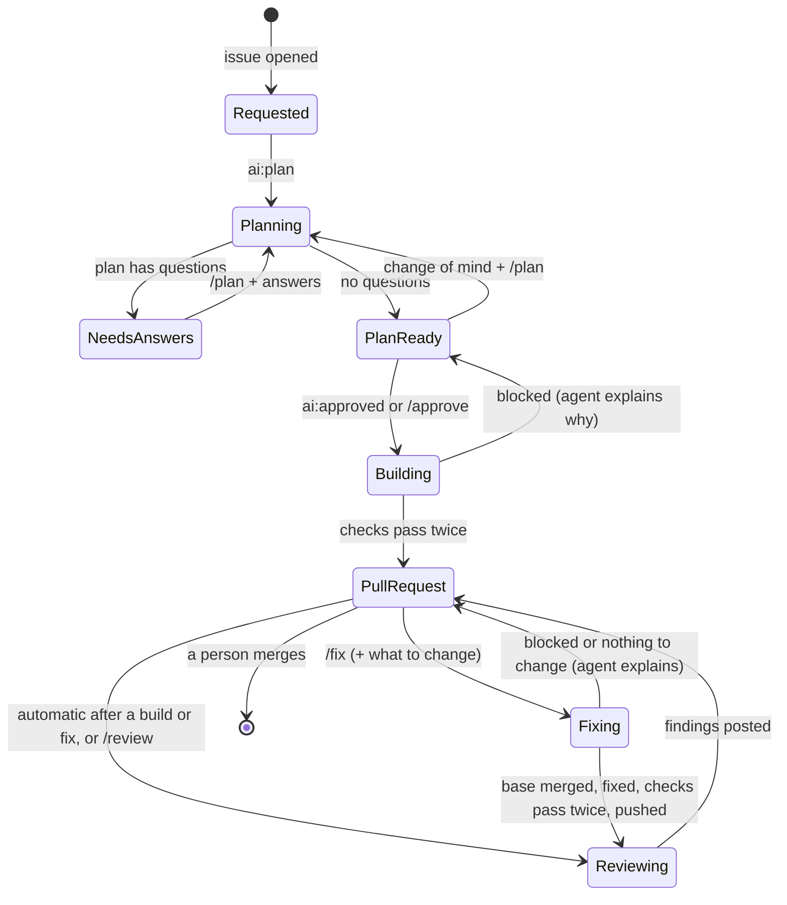
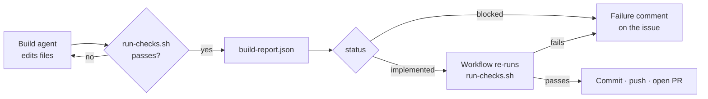
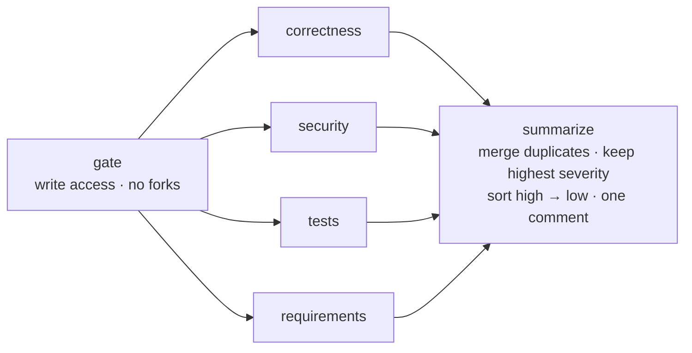

# Architecture

The pipeline is three GitHub Actions workflows. Each one wraps a single Claude Code agent run (four in parallel for
review) with deterministic steps before and after it.

```text
┌────────────── workflow job ───────────────────────────────────────────────────┐
│  gate            context           agent                act                   │
│  write access ─▶ issue thread  ─▶  claude-code-action ─▶ render JSON, then    │
│  (+ allow-list)  diff, CLAUDE.md   skill + schema        comment / commit / PR │
└───────────────────────────────────────────────────────────────────────────────┘
```

The same four parts repeat in every stage:

1. **Gate**: `require-write-access.sh` stops the job unless the person who added the label or wrote the command has
   write access (and is on the optional allow-list). `claude-code-action` makes the same check again before the
   agent starts.
2. **Context**: `gather-issue-context.sh` writes the issue thread to `.pipeline/issue.md`, keeping only comments by
   collaborators and the pipeline. The review stage also writes the pull request's diff.
3. **Agent**: `anthropics/claude-code-action@v1` in automation mode, with a skill as the prompt, a restricted tool
   list, deny rules, a turn limit and a JSON schema for its answer.
4. **Act**: jq renders the JSON to markdown and the workflow posts, labels, commits or opens the pull request.

## How a stage runs

Using the build stage as the example; plan and review work the same way.

1. **An event starts the workflow.** Everything on GitHub is an event: adding a label, posting a comment. Each
   workflow file says which events it listens to (`on:`) and filters them (`if:`). Adding `ai:approved` to an issue
   is an `issues.labeled` event; `ai-build.yml` matches it, `ai-plan.yml` sees a different label and skips.
2. **A fresh runner runs the job's steps in order.** GitHub starts a clean Linux machine, checks out the repository
   and runs each step top to bottom. A step is a shell command (`run:`) or a ready-made action (`uses:`). When one
   fails the rest are skipped, except the `if: failure()` step that reports the failure on the issue.
3. **Scripts prepare the agent's input.** The gate (`require-write-access.sh`) and context
   (`gather-issue-context.sh` → `.pipeline/issue.md`) steps are plain bash, the same every time.
4. **The Claude step runs the agent.** `anthropics/claude-code-action` installs Claude Code on the runner, signs in
   with the repository secret, and runs it non-interactively in the checkout with `prompt: /pipeline-build`. Claude
   Code loads `CLAUDE.md` (the project's rules) and the named skill (the stage's instructions), works with only the
   tools in `--allowedTools`, and must finish with JSON matching the schema given in `--json-schema`. The action
   validates it and exposes it as the step output `structured_output`.
5. **Scripts act on the answer.** Later steps receive that JSON through an environment variable
   (`REPORT_JSON: ${{ steps.claude.outputs.structured_output }}`). In the build stage, `commit-change.sh` checks
   `status`, builds the commit message and commits locally, and the commits go to a separate **publish** job (a fresh
   runner, the only one with write access), whose `publish.sh` pushes and opens or comments on the pull request.

In one line: **event → workflow `if:` → scripts prepare files → Claude reads them and returns JSON in a fixed
shape → scripts act on the JSON.** Claude never calls GitHub; it reads and edits files on the runner and answers.

| | Plan | Build | Fix | Review |
| --- | --- | --- | --- | --- |
| Trigger | `ai:plan` / `/plan` | `ai:approved` / `/approve` | `/fix` on the PR | automatic after a build or fix; `/review` |
| Workflow | `ai-plan.yml` | `ai-build.yml` | `ai-build.yml` (fix mode) | `ai-review.yml` |
| Skill | `/pipeline-plan` | `/pipeline-build` | `/pipeline-fix` | `/pipeline-review <lens>` ×4 in parallel |
| Claude can | read | read, edit, run `run-checks.sh` | read, edit, run `run-checks.sh` | read |
| Returns | `plan.schema.json` | `build-report.schema.json` | `build-report.schema.json` | `review-findings.schema.json` |
| Scripts then | post the plan, set labels | re-run checks, commit, open the PR | merge the base first; re-run checks, commit, push to the same PR | merge the 4 results into one comment |

Every stage posts **⏳ started** with a link to its run, and `/cancel` (`ai-cancel.yml`) stops any of them.

## Issue lifecycle



## Stage 1 — Plan (`ai-plan.yml`)

| | |
| --- | --- |
| Trigger | `issues.labeled` with `ai:plan`, or an issue comment starting with `/plan` |
| Agent | `/pipeline-plan` · tools `Read, Glob, Grep` · 60 turns · 30-minute job (adjustable) |
| Output | [`plan.schema.json`](../templates/pipeline/schemas/plan.schema.json): summary, approach, steps, files, risks, questions, readyToBuild |
| Effect | a plan comment (marked `<!-- ai-pipeline:plan -->`); label `ai:needs-answers` or `ai:plan-ready` |

The planner decides technical details itself and asks only about what the requester must decide: behaviour, scope,
trade-offs and anything destructive. Re-planning reads the earlier plan and the answers from the thread, so the plan
converges instead of starting over.

## Stage 2 — Build (`ai-build.yml`)

| | |
| --- | --- |
| Trigger | `issues.labeled` with `ai:approved`, or an issue comment starting with `/approve` (either is the approval) |
| Precondition | the issue has at least one plan comment |
| Agent | `/pipeline-build` · tools `Read, Glob, Grep, Edit, Write, Bash(./pipeline/scripts/run-checks.sh)` · 200 turns · 120-minute job (adjustable) |
| Output | [`build-report.schema.json`](../templates/pipeline/schemas/build-report.schema.json): status, summary, changes, checks, followUps, commit (Conventional Commits header) |
| Effect | checks run again by the workflow → `commit-change.sh` commits on branch `ai/issue-N-<timestamp>` and bundles it → the **publish** job (fresh runner, write access) pushes it and opens a pull request that closes the issue |

The build job itself has read-only access to the repository: the agent and the checks (which run tests the agent
wrote) never share a runner with a token that can push. The publish job reads only the bundle, the report and the
metadata, and runs scripts from its own checkout of the default branch.



The agent can't commit, push or call GitHub. If it reports success but changed nothing, or reports success while the
checks fail, the workflow stops and comments on the issue instead of opening a pull request.

## Stage 2b — Fix (`ai-build.yml`, fix mode)

| | |
| --- | --- |
| Trigger | a pull request comment starting with `/fix`; the text after it is the request (none = fix the AI review's findings) |
| Context | `.pipeline/pr.md`: the request, the description, the conversation (incl. the AI review) and comments on lines of code, from collaborators only; `.pipeline/issue.md`; `.pipeline/diff.patch` |
| Before the agent | the pipeline's scripts and settings are copied from the default branch and used from there; `merge-base.sh` merges the latest base branch (a clean merge is committed, conflicts are left for the agent and listed in `.pipeline/conflicts.txt`; if the base changed workflow files it stops, since the workflow token can't push those); `snapshot-config.sh save` keeps the branch's `CLAUDE.md` / `.claude/`, which `claude-code-action` swaps for the default branch's copies on pull request events |
| Agent | `/pipeline-fix` · same tools and limits as the build |
| Output | `build-report.schema.json` |
| Effect | `commit-change.sh`: restores the saved `CLAUDE.md` / `.claude/`; refuses while conflict markers remain; commits (Conventional Commits header from the report) and bundles; then the publish job pushes to the pull request's own branch and comments what changed, and the review runs again |

The same workflow runs build and fix, so the toolchain is configured once. It runs only on pull requests from the same
repository.

## Stage 3 — Review (`ai-review.yml`)

| | |
| --- | --- |
| Trigger | called by the build workflow right after it opens or updates the pull request (`workflow_call`); or `pull_request.labeled` with `ai:review`, or a pull request comment starting with `/review`, to run again |
| Jobs | `gate` → `review` (matrix of 4 lenses, `fail-fast: false`) → `summarize` |
| Agent | `/pipeline-review <lens>` · tools `Read, Glob, Grep` · 60 turns · 30-minute job each (adjustable) |
| Output | [`review-findings.schema.json`](../templates/pipeline/schemas/review-findings.schema.json): lens, verdict, findings (severity, file, line, title, detail, suggestion) |
| Effect | one review comment on the pull request, edited in place on re-review |

The base branch is checked out at the root and the pull request's code in `pr/`. The prompts, settings and scripts
therefore always come from the base branch: a pull request can't change how it is reviewed.



The reviewers don't see each other's findings, so they don't anchor on one another. The summary merges findings
that several lenses reported for the same file, line and title, and keeps the highest severity and every lens that
found it, so agreement between independent reviewers is visible.

## Concurrency and cancelling

Each stage runs in a concurrency group named after its issue or pull request: `ai-plan-N`, `ai-build-N` (build and
fix) and `ai-review-N`. A new `/plan` or `/review` replaces one still running; builds and fixes queue. Every comment
starts a run of each workflow, so comments that aren't the stage's command get a throwaway group and are skipped
without touching a running stage. `/cancel` (`ai-cancel.yml`) joins the issue's or pull request's groups with
`cancel-in-progress: true`, which stops whatever runs there; because commits and comments happen only after the
agent finishes, a cancelled stage leaves nothing half-done.

## Data contracts

Every agent returns JSON that `claude-code-action` validates against a schema (`--json-schema`, exposed as the
action's `structured_output`). The renderers are pure jq programs, tested against fixtures:

| Producer | Schema | Renderer | Consumer |
| --- | --- | --- | --- |
| plan agent | `plan.schema.json` | `render-plan.jq` | issue comment, labels |
| build agent | `build-report.schema.json` | `render-pr-body.jq` | pull request description |
| review agents | `review-findings.schema.json` | `render-review.jq` | pull request comment |
| `gh issue view` | — | `issue-context.jq` | the agents (`.pipeline/issue.md`) |

## Why skills

Each stage's prompt is a [Claude Code skill](https://code.claude.com/docs/en/skills) in `.claude/skills/`. Skills
are versioned with the code, reviewed in pull requests like any other change, and can be run locally
(`/pipeline-plan` in an interactive session) to try a prompt change before it reaches the pipeline.
