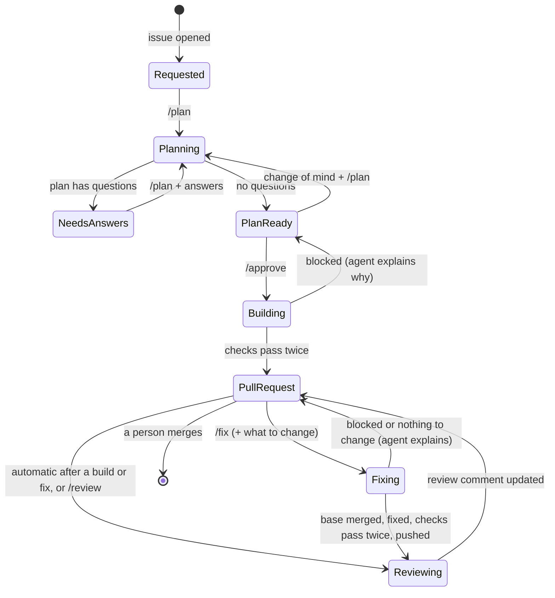
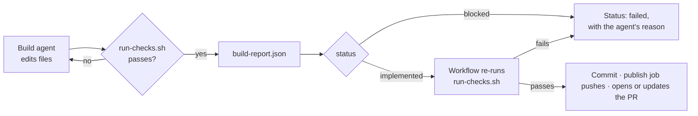
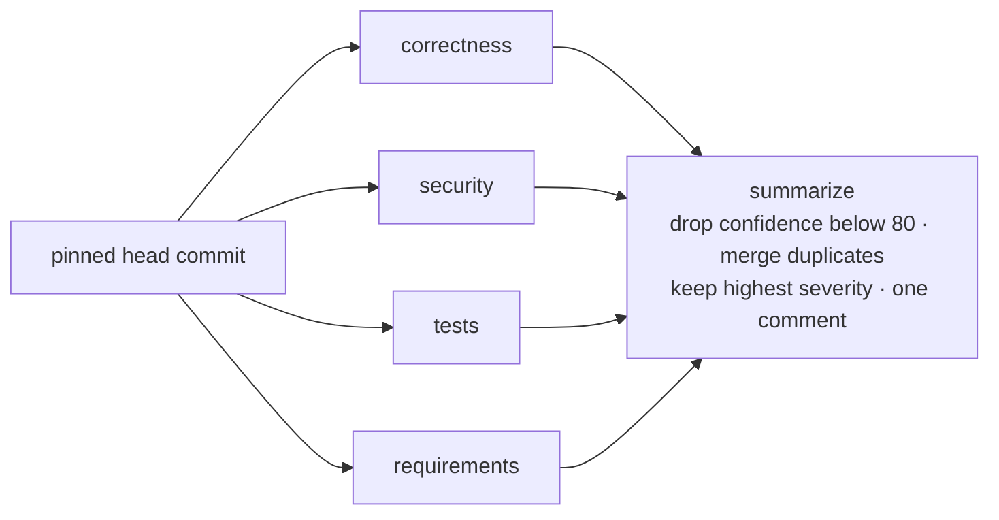

# Architecture

The pipeline is **one GitHub Actions workflow**, `ai-pipeline.yml`, started by comment commands. Each command runs a
few jobs: deterministic steps before and after a Claude Code agent run (four in parallel for the review).

```text
┌──────────────────────────── one run per command comment ─────────────────────────────┐
│  prepare            agent job(s)                    act                     finish    │
│  command, access ─▶ claude-code-action, skill  ─▶   post plan / push + PR ─▶ status   │
│  👀 + status         + schema, read-only tools        / review comment        ✅ or ⚠️ │
└───────────────────────────────────────────────────────────────────────────────────────┘
```

## How a command runs

1. **A comment starts the workflow.** Posting a comment is an `issue_comment` event. GitHub starts the workflow for
   every comment (there's no way to filter on the text before a run starts) and names the run after the command, for
   example **/fix #3 · Add due dates** (the issue or pull request title). Comments that don't start with `/` skip every job.
2. **`prepare` reads the command and checks the requester.** `parse-command.sh` accepts only an exact command as the
   comment's first word, in the right place (`/plan` and `/approve` on issues, `/fix` and `/review` on pull requests,
   `/cancel` on both). `require-write-access.sh` checks write access through the API (and the optional allow-list).
   Anything else does nothing and posts nothing.
3. **It acknowledges and works out the target.** 👀 on your comment, and one status comment: **⏳ Fix running · follow
   the run · comment `/cancel` to stop it**. Then the target: for `/approve` the exact default-branch commit to build
   on; for `/fix` and `/review` the pull request's head commit, pinned now, so later pushes can't slip into the run.
   `/approve` also needs the latest plan before it to be ready (`approved-plan.sh`), and pins the issue thread at the
   `/approve` comment: the build, and the reviews and fixes of its pull request (which records the comment's ID), read
   the thread only up to it, so a `/plan` posted later can't change what is built or what it is reviewed against.
4. **The agent job runs.** `anthropics/claude-code-action` installs Claude Code on a fresh runner and runs it
   non-interactively with a skill as the prompt (`/pipeline-plan`, `/pipeline-build`, `/pipeline-fix`,
   `/pipeline-review <lens>`). Claude Code loads `CLAUDE.md` and the skill, works with only the tools in
   `--allowedTools`, and must finish with JSON matching `--json-schema`; the action exposes it as `structured_output`.
   The step gets the job's own GitHub token (`github_token`), so no Claude GitHub App token is minted.
5. **Scripts act on the JSON.** Post the plan; or commit, push and open / update the pull request; or post the review.
6. **`finish` sets the result.** The status comment becomes **✅ Fix done · pushed the fix · AI review: no blocking
   findings** (with links) or **⚠️ Fix failed** with the reason, and your comment gets 👍 or 👎 (😕 when a build or fix was pushed but its review didn't finish).

Claude never calls GitHub: it reads and edits files on the runner and answers in JSON.

| Command | Jobs | Claude can | Returns | Then |
| --- | --- | --- | --- | --- |
| `/plan` (issue) | prepare → plan → finish | read | `plan.schema.json` | plan comment, status label |
| `/approve` (issue) | prepare → build → publish → review ×4 → summarize → finish | read, edit, run `run-checks.sh` | `build-report.schema.json` | new branch, pull request, review |
| `/fix` (PR) | same as `/approve` | same | same | commits on the PR's branch, a comment saying what changed, review |
| `/review` (PR) | prepare → review ×4 → summarize → finish | read | `review-findings.schema.json` | a new review comment |
| `/cancel` | prepare → cancel | — | — | cancels the running commands there |

## Issue lifecycle



## Plan

| | |
| --- | --- |
| Trigger | `/plan` on an issue (with your answers or changes after it, when re-planning) |
| Agent | `/pipeline-plan` · tools `Read, Glob, Grep` · 60 turns · 30-minute job (adjustable) |
| Output | [`plan.schema.json`](../templates/pipeline/schemas/plan.schema.json): summary, approach, steps, files, acceptanceCriteria, risks, questions, readyToBuild |
| Effect | a plan comment (marked `<!-- ai-pipeline:plan -->`); status label `ai:needs-answers` or `ai:plan-ready` |

The planner decides technical details itself and asks only about what the requester must decide: behaviour, scope,
trade-offs and anything destructive. It turns the request's acceptance criteria into checkable ones, each with how it
is checked, and asks about any that are vague; the builder works to that list and the requirements reviewer checks
the pull request against it. Re-planning reads the earlier plan and the answers from the thread, so the plan
converges instead of starting over.

## Build (`/approve`) and Fix (`/fix`)

| | |
| --- | --- |
| Precondition | build: the issue has a plan comment from the pipeline; fix: an open pull request from this repository |
| Agent | `/pipeline-build` or `/pipeline-fix` · tools `Read, Glob, Grep, Edit, Write, Bash(./pipeline/scripts/run-checks.sh)`, `Bash(diff *)`, `Bash(git diff *)` (to compare copied code) · 200 turns · 120-minute job, 60 minutes per command (adjustable) |
| Output | [`build-report.schema.json`](../templates/pipeline/schemas/build-report.schema.json): status, summary, changes, checks, followUps, commit (Conventional Commits header) |
| Fix context | `.pipeline/pr.md`: what you asked after `/fix` (none = the AI review's findings), the description, the conversation and comments on lines of code, from collaborators only; `.pipeline/issue.md`; `.pipeline/diff.patch` |
| Before a fix | `merge-base.sh` merges the latest base branch (a clean merge is committed; conflicts are left for the agent and listed in `.pipeline/conflicts.txt`); it stops early, with what to do, on conflicts in files the agent may not change, binary files or deleted files, and when the base changed workflow files (the workflow token can't push those). `snapshot-config.sh` keeps the branch's `CLAUDE.md` / `.claude/`, which `claude-code-action` swaps for the default branch's copies on pull request events |

Write access is kept away from everything the agent touched:

| Job | Can | Why |
| --- | --- | --- |
| `prepare` | comment | checks the command and the requester, pins the target, posts the status; runs before any agent code exists |
| `build` | read only | runs the agent and the checks (tests the agent wrote), commits locally, uploads the commits and report as an artifact |
| `publish` | push, open PRs, comment | a fresh runner; pushes only where `prepare` decided and only commits on top of the pinned commit (a build: a new branch `ai/issue-N-<run>-<attempt>`, never over an existing one, so `main` can move on meanwhile; a fix: the PR's branch, only while it's still at the pinned commit); refuses titles that aren't Conventional Commits and changes to workflow files |
| `finish` | comment | turns the jobs' results into the status (a job stopped at its time limit counts as failed; a build or fix that was pushed but whose review didn't finish says so, with the link, rather than "failed") |

Everything after the agent's step in the build job may be influenced by code the agent wrote, so nothing it hands
over decides where commits go: `publish.sh` takes the target from `prepare` and uses only the commits and text from
the artifact.



The agent can't commit, push or call GitHub. If it reports success but changed nothing, or reports success while the
checks fail, nothing is pushed and the status says why.

## Review

| | |
| --- | --- |
| Trigger | automatically in the same run, right after a build or fix pushes; or `/review` on a pull request |
| Jobs | `review` (matrix of 4 lenses, `fail-fast: false`) → `summarize` |
| Agent | `/pipeline-review <lens>` · tools `Read, Glob, Grep` · 100 turns · 45-minute job each (adjustable) |
| Output | [`review-findings.schema.json`](../templates/pipeline/schemas/review-findings.schema.json): lens, verdict, previous (what happened to each finding of the last review), findings (severity, confidence, file, line, title, detail, suggestion) |
| Context | `.pipeline/diff.patch` and the changed-file list; `.pipeline/pr.md` (the description, including the build agent's follow-ups and anything it says it couldn't verify, and the collaborators' conversation); `.pipeline/issue.md`; `.pipeline/previous-findings.json` (this lens's findings from the last review: `prepare` finds that comment once with `last-review.sh`, so all four lenses check the same one, and `previous-findings.sh` reads them from it) |
| Effect | a new review comment on the pull request for every review, never an edit of an earlier one; a re-review opens with **Since the last review** (linking to it: fixed, still there, no longer applies); the command's status links to it |

The default branch is checked out at the root and the pinned head commit in `pr/`. The prompts, settings and scripts
therefore always come from the default branch: a pull request can't change how it is reviewed.



Each reviewer reads every changed file its lens covers in full (riskiest first), compares any copied or redefined code
with the original by reading both, checks anything the build agent flagged as unverified, and reports its
**coverage**: the files it checked and anything it didn't (shown as "Files checked" and "⚠️ Not checked"), so a
skimmed review is visible. Reviewers have no shell, deliberately: a read-only `diff` could still print the process
environment (`/proc/self/environ`) and its Claude credential.

The reviewers don't see each other's findings, so they don't anchor on one another. Each finding carries a confidence
score; anything below 80 (`PIPELINE_REVIEW_MIN_CONFIDENCE`) is left out and counted, because a reviewer asked to find
problems always finds something. Findings that several lenses report for the same file, line and title are merged,
keeping the highest severity and every lens that found it.

## Concurrency and cancelling

Runs are grouped per issue or pull request: one plan (`ai-plan-N`), one build or fix (`ai-build-N`) and one review
(`ai-review-N`) at a time. A new `/plan` or `/review` replaces the one still running (its status says "replaced"). A
build or fix waits for the one running, but GitHub keeps only the newest waiting run per group: an earlier waiting
command is dropped without a reply (it never reached `prepare`). Every other comment gets a group of its own, so it
never touches a run, except a near-miss such as `/planning` or a `/plan` from someone without write access: groups are
resolved before anyone can check the comment, so that one replaces a running plan (or review) and then does nothing.

`/cancel` looks up this workflow's runs still going for the same issue or pull request (by the run name, for example
**/fix #3 · …**; on a pull request also the `/approve` run of the issue it closes), cancels them through GitHub's
REST API (`POST /actions/runs/{id}/cancel`), and marks the status **⏹ cancelled** of each run it really cancelled. A cancel while the agent works pushes nothing (only the publish job pushes); a cancel
that lands during publishing may leave the branch or pull request it was creating.

## Data contracts

Every agent returns JSON that `claude-code-action` validates against a schema (`--json-schema`, exposed as the
action's `structured_output`). The renderers are pure jq programs, tested against fixtures:

| Producer | Schema | Renderer | Consumer |
| --- | --- | --- | --- |
| plan agent | `plan.schema.json` | `render-plan.jq` | issue comment, status labels |
| build agent | `build-report.schema.json` | `render-pr-body.jq`, `commit-message.jq` | pull request description, commit message |
| review agents | `review-findings.schema.json` | `render-review.jq` | the review comment |
| `gh issue view` / `gh pr view` | — | `issue-context.jq`, `pr-context.jq` | the agents (`.pipeline/issue.md`, `.pipeline/pr.md`) |

## Why skills

Each stage's prompt is a [Claude Code skill](https://code.claude.com/docs/en/skills) in `.claude/skills/`. Skills
are versioned with the code, reviewed in pull requests like any other change, and can be run locally
(`/pipeline-plan` in an interactive session) to try a prompt change before it reaches the pipeline.
