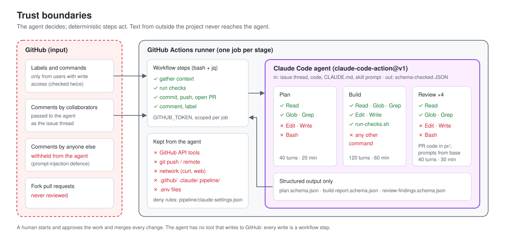

# Security model

Two principles shape the design:

1. **The agent decides; deterministic steps act.** Agents read and, in the build stage, edit files. Everything with
   an effect outside the runner (comments, labels, commits, pushes, pull requests) is a plain workflow step.
2. **Only the project's people steer the agent.** Who can start a run, and whose text reaches the agent, is limited
   to collaborators.

## Threats and mitigations

| Threat | Mitigation | Where |
| --- | --- | --- |
| A stranger triggers runs on a public repository (cost, abuse) | Write access required, checked by the pipeline before any step and by `claude-code-action` before the agent; optional `PIPELINE_ALLOWED_USERS` allow-list; bots rejected by the action unless allowed | `require-write-access.sh`, action defaults |
| Prompt injection through issue comments | Comments from people without write access (checked through the API, since GitHub reports private organization members as CONTRIBUTOR) are replaced with a "withheld" note before the agent sees the thread | `trusted-authors.sh`, `issue-context.jq`, `pr-context.jq` (tested) |
| A pull request's branch changes the pipeline's own scripts | In fix mode the pipeline copies its scripts and settings from the default branch before checking out the pull request's branch, and runs those; only `run-checks.sh` (the project's checks) runs from the branch | `ai-build.yml` |
| Strangers start runs with command comments | Every job checks write access through the API before doing anything; `/cancel` acts only after that check | workflows, `require-write-access.sh` |
| Code the agent writes (tests) reaches GitHub or the cloud | `run-checks.sh` drops the GitHub, OIDC, cloud and Claude credentials from its environment and resets the `origin` URL before running project code; the Claude step runs with `CLAUDE_CODE_SUBPROCESS_ENV_SCRUB=1`; the agent can't read `.git/` or `$RUNNER_TEMP/secrets` | `run-checks.sh`, workflows, `claude-settings.json` |
| Prompt injection through the issue body | A collaborator decides to run the pipeline on an issue; the docs say to read a stranger's issue before labelling it | process |
| A pull request rewrites its own review prompts or scripts | Review jobs run prompts, settings and scripts from the base branch; the PR's code is checked out read-only in `pr/` without credentials | `ai-review.yml` |
| Fork pull requests | Rejected by the review gate and the fix stage (`isCrossRepository`); GitHub also withholds secrets from fork runs | `ai-review.yml`, `ai-build.yml` |
| A fix pushes something the PR's people didn't ask for | `/fix` needs write access; the request and the context come only from collaborators' comments; the fix pushes only to that pull request's own branch, never to the base | `gather-pr-context.sh`, `push-fix.sh` |
| A fix pushes unresolved merge conflicts | `push-fix.sh` refuses to push while conflict markers remain | `push-fix.sh` |
| The agent pushes, calls GitHub or exfiltrates over the network | No git, `gh`, curl, web or MCP tools: allowed tools are listed per stage, and deny rules block the rest | `--allowedTools`, `--disallowedTools`, `claude-settings.json` |
| Code the agent writes (tests) reaches GitHub | `GH_TOKEN` is set only on steps that call GitHub; checkouts use `persist-credentials: false`; the push step sets up git credentials after the agent has finished | workflows |
| The build agent weakens the quality gate | `run-checks.sh` and everything under `pipeline/`, `.github/` and `.claude/` are denied to `Edit` / `Write`; the workflow re-runs the checks itself; the tests reviewer looks for tests that can't fail | `claude-settings.json`, `ai-build.yml`, review lens |
| The agent reports success that isn't true | The workflow re-runs the checks and confirms files changed before it opens a pull request | `ai-build.yml`, `open-pr.sh` |
| Secrets leak into code or logs | Credentials only in GitHub secrets; `.env` files denied to `Read`; the build skill forbids writing secrets; `show_full_output` left off (public logs) | settings, skill |
| Runaway cost | Turn limits per agent, job timeouts, concurrency groups, runs start only from a person's label or command (the review follows a build the person approved) | workflows |
| Shell injection from issue text | Event text reaches scripts only through environment variables, never interpolated into `run:` blocks | workflows (checked by `tests/run.sh`) |
| An agent change merges without a person | The pipeline never approves or merges; branch protection should require a human approval | [setup](setup.md#10-recommended-repository-settings) |

## Permissions per job

| Job | `contents` | `issues` | `pull-requests` | `id-token` |
| --- | --- | --- | --- | --- |
| plan | read | write | — | write |
| build | write | write | write | write |
| review: gate | read | — | read | — |
| review: reviewers | read | read | read | write |
| review: summarize | read | write | write | — |

`id-token: write` is required by `claude-code-action` for its GitHub App authentication. Jobs that don't run the
action don't get it.

## Residual risks

- **The issue body is trusted once a collaborator labels the issue.** Read requests from outside the project before
  starting the pipeline on them.
- **`run-checks.sh` runs project code, including tests the agent wrote.** During the Claude step `claude-code-action`
  holds its own short-lived GitHub App token (in its environment and the `origin` URL; revoked when the step ends).
  `run-checks.sh` removes those and the job's OIDC request token before running project code, but a package-feed
  config written for the build (for example a CodeArtifact token in `$RUNNER_TEMP/secrets/`) is still usable by that
  code. Give the build only **read** access to package feeds, review pull requests before merging, and keep tests
  free of network calls.
- **Command comments from strangers.** Concurrency groups are resolved before any job can check who commented, so on a
  public repository anyone's `/plan` or `/review` can cancel a run in progress (and `/approve` or `/fix` replace a
  queued one). Nothing runs for them. Limit interactions if needed (setup step 10).
- **Prompt-injection defences are layered, not absolute.** The agents' limited tools are what bound the damage if
  an injection succeeds: no agent can push, comment or reach the network.
